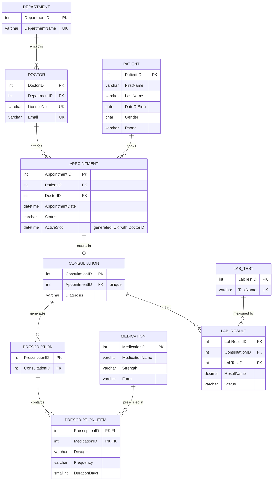

# Portfolio 1: Database Design and Modelling

## 1. Selected case study

**Organisation / scenario:** St. Jude Clinical Health Information System (HIS), a simulated private clinic.

**Nature of the system:** A relational database that supports day-to-day clinic operations: registering patients, booking appointments, recording consultations and diagnoses, issuing prescriptions and tracking laboratory tests.

**Users of the database:** receptionists (register patients, book appointments), doctors (record diagnoses, prescribe, order lab tests), laboratory staff (enter results), and administrators (reports).

**Major data stored:** patients, doctors, departments, appointments, consultations/diagnoses, medications, prescriptions, laboratory tests and results.

**Key operations supported:**
- Book an appointment without double-booking a doctor
- Cancel an appointment and free the slot
- Record a diagnosis for an attended appointment
- Issue a prescription containing several medications
- Order a lab test and record its result
- Retrieve a patient's full history

## 2. Entity-Relationship diagram



## 3. Relational schema (summary)

| Table | Primary key | Foreign keys | Other constraints |
|---|---|---|---|
| Department | DepartmentID | none | UNIQUE(DepartmentName) |
| Doctor | DoctorID | DepartmentID -> Department | UNIQUE(LicenseNo), UNIQUE(Email) |
| Patient | PatientID | none | CHECK Gender IN (M,F,O), UNIQUE(Email) |
| Appointment | AppointmentID | PatientID -> Patient, DoctorID -> Doctor | CHECK Status; UNIQUE(DoctorID, ActiveSlot) |
| Consultation | ConsultationID | AppointmentID -> Appointment | UNIQUE(AppointmentID) enforces 1:1 |
| Medication | MedicationID | none | UNIQUE(Name, Strength, Form) |
| Prescription | PrescriptionID | ConsultationID -> Consultation | none |
| PrescriptionItem | (PrescriptionID, MedicationID) | both | CHECK DurationDays > 0, ON DELETE CASCADE from Prescription |
| LabTest | LabTestID | none | UNIQUE(TestName) |
| LabResult | LabResultID | ConsultationID, LabTestID | CHECK Status |

Full DDL: [`01_schema.sql`](01_schema.sql). Sample data: [`02_seed_data.sql`](02_seed_data.sql). Tests: [`03_verify.sql`](03_verify.sql).

## 4. Key design decisions

- **Double-booking prevention** uses a database-level constraint, `UNIQUE (DoctorID, ActiveSlot)`, rather than relying on application code. `ActiveSlot` is a stored generated column equal to `AppointmentDate` unless the appointment is `Cancelled`, in which case it is `NULL`. MySQL allows multiple NULLs in a unique index, so cancelled appointments free their slot while every live appointment still blocks duplicates.
- **Consultation is separate from Appointment** because not every appointment is attended (cancelled, no-show). Merging them would create NULL-heavy rows. The 1:1 relationship is enforced with a UNIQUE foreign key.
- **PrescriptionItem is a junction table** because one prescription contains many medications and one medication appears on many prescriptions.
- **Medication and LabTest are catalogues**, so names, strengths and reference ranges are stored once.

## 5. Normalisation explanation

**Unnormalised starting point.** A single flat "visit record" might look like:

`PatientName | PatientPhone | DoctorName | DoctorDepartment | AppointmentDate | Diagnosis | Medications`

with `Medications` holding values such as `"Amlodipine 5mg, Paracetamol 500mg"`.

**First Normal Form (1NF): atomic values, no repeating groups.** The `Medications` column held several values in one cell. Each medication now gets its own row in `PrescriptionItem`.

**Second Normal Form (2NF): no partial dependency on part of a composite key.** In `PrescriptionItem`, the key is (PrescriptionID, MedicationID). Dosage, frequency and duration depend on the whole key. But medication name, strength and form depend only on MedicationID, so they were moved to `Medication`.

**Third Normal Form (3NF): no transitive dependency.** In a flat doctor record, `DepartmentName` depends on `DepartmentID`, which depends on `DoctorID`. That is a transitive dependency, so department data moved to `Department`. Likewise, appointments store only `PatientID` and `DoctorID`, never patient or doctor names.

**Result:** every non-key attribute depends on the key, the whole key, and nothing but the key. Updating a department name, a drug's strength or a patient's phone is a single-row change with no anomalies.

## 6. How to run and test

```bash
mysql -u root -p < 01_schema.sql
mysql -u root -p < 02_seed_data.sql
# then run 03_verify.sql block by block and screenshot the results
```

Expected results of the tests in `03_verify.sql`: Tests 3, 5 and 6 fail with a duplicate-key, CHECK and foreign-key error respectively. Tests 4 and 7 succeed.
